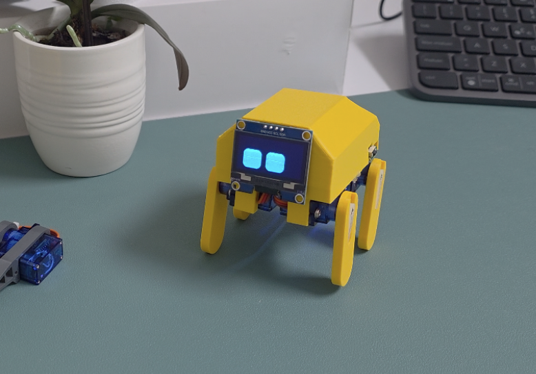
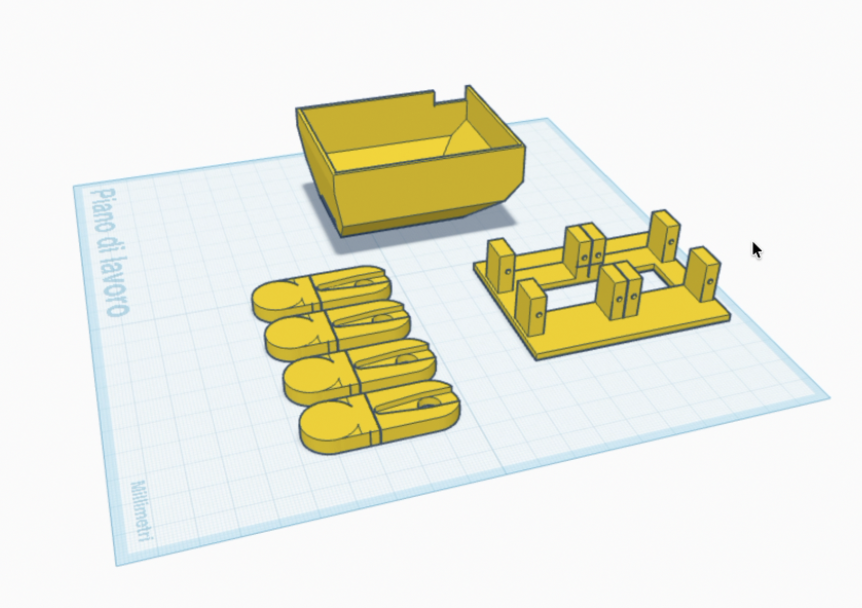

# AlbertMicro — Arduino Nano

AlbertMicro is a four-servo robot running on a **classic Arduino Nano
(ATmega328P, 5 V)** and a Nano I/O expansion shield. This version uses USB
Serial commands and a SH1106 OLED face. The main sketch is `AlbertMicro.ino`.

| Assembled robot | Printed parts |
|---|---|
|  |  |

The [original ESP32 sketch and instructions](firmware/esp32_original/README.md)
are preserved separately. The classic Nano has no built-in Wi-Fi or Bluetooth,
so this version omits BLE control, network time, weather, and YouTube statistics.
`INFO` shows uptime, servo output angles and whether servo pulses are enabled.

## Wiring

Leg order is from the robot's viewpoint, facing forward:

| Connection | Nano / shield pin |
|---|---|
| Front-left servo signal | **D3 / S** |
| Front-right servo signal | **D5 / S** |
| Back-left servo signal | **D6 / S** |
| Back-right servo signal | **D9 / S** |
| OLED SDA | **A4** |
| OLED SCL | **A5** |
| OLED GND | **GND** |
| OLED VCC | According to the display module's rating |

Servo orange/yellow is signal, red is positive supply, and brown/black is
GND. Check the shield's **S / V / G** labels rather than assuming row order.
D0 and D1 remain free for USB Serial.

Supply the servos externally and join supply GND to Nano GND. Do not run four
servos through the Nano's USB power or onboard regulator. For initial testing,
power the Nano through USB and the servos from a separate suitable supply.
Four NiMH rechargeable AAs provide 4.8 V nominal for the servo supply; four
alkaline AAs provide 6 V nominal and should use a suitable regulated 5 V output
for this build. **Do not connect either raw pack to the Nano's 3V3 or 5V pin.**

The exact Hailege shield power routing has not been verified. Until its manual
or circuit is checked, connect servo red wires directly to the external servo
supply rather than guessing which DC socket or jumper feeds the shield's V rail.

Use 5 V for OLED VCC only if the complete module supports 5 V power and I2C
signals. A 3.3 V-only OLED needs an appropriate supply and I2C level shifting.
The configured display is **SH1106, 128x64, I2C address 0x3C**. A missing display
is detected at startup and does not prevent motion commands.

## Build and upload

In Arduino IDE:

1. Install **Arduino AVR Boards** through Boards Manager.
2. Select **Arduino Nano → ATmega328P**. The previously connected Nano accepted
   the standard bootloader option; use Old Bootloader only for a board that needs it.
3. Install **Servo** and **U8g2** through Library Manager. Versions used for this
   port are Servo **1.3.0**, U8g2 **2.36.19**, AVR Boards **1.8.8**.
4. Open `AlbertMicro.ino`, select the Nano's USB port, then upload.
5. Open Serial Monitor at **115200 baud**, with **Newline** ending.

With Arduino CLI, from this folder:

```sh
arduino-cli lib install Servo@1.3.0 U8g2@2.36.19
arduino-cli compile --fqbn arduino:avr:nano .
arduino-cli board list
# Replace PORT with the Nano's current USB port:
arduino-cli compile --fqbn arduino:avr:nano --upload --port PORT .
```

The OLED uses a 128-byte page buffer and simple blinking, expressive eyes to
fit the Nano's 2 KB RAM. This replaces the ESP32 version's RoboEyes renderer.
To build without OLED support or its library, set `ALBERT_OLED` to `0` at the
start of the sketch, or pass `--build-property build.extra_flags=-DALBERT_OLED=0`.

## Commands

Commands are case-insensitive. Use newline or carriage return after each command.

| Command | Action |
|---|---|
| `F` / `B` | Two forward/backward gait cycles, then center and disable pulses |
| `WALK` / `BACK` | Continuous forward/backward gait until another motion command or `STOP` |
| `LEFT` / `RIGHT` | Continuous left/right turning gait |
| `SL` / `SR` | Continuous spin gait |
| `STOP` / `S` | Cancel motion and immediately disable servo pulses |
| `!` | Immediately stop, without needing a newline |
| `UP` | Center legs and hold |
| `DOWN` | Lower pose and hold |
| `REST` | Lower pose, then disable pulses; tired eyes |
| `INFO` | Sit and show uptime, commanded output angles and servo status |
| `PUSHUPS` / `SWING` / `GALLOP` | Finite trick, then return to center and hold |
| `HAPPY` / `ANGRY` / `TIRED` / `CURIOUS` / `DEFAULT` | Change the eyes without changing motion |
| `HELP` / `?` | List commands |

On boot, the servos remain detached: there is **no automatic walking or full-travel
REST movement**. Walking, poses and tricks are nonblocking, so STOP can interrupt
them. STOP disables holding torque; support the robot when needed. Commanded
angles and completion messages are software reports, not servo position feedback.

## Servo configuration

At the top of the sketch:

- `SERVO_PINS`: `{3, 5, 6, 9}`, in FL / FR / BL / BR order.
- `SERVO_DIRECTIONS`: `{1, 1, -1, -1}`. Rear output directions were reversed after
  the owner reported opposite front/rear rotation. Physical walking direction
  still needs confirmation.
- `SERVO_TRIM`: neutral adjustment for each joint, initially all zero.
- `SERVO_MIN` / `SERVO_MAX`: physical output bounds, initially 20°–160°.
- Servo pulse range: **1000–2000 microseconds**, matching the Nano test sketches.
- `WALK_OFFSETS`, `WALK_PHASES`, `AMPLITUDE`, `GAIT_CYCLE_MS`: gait tuning.

These software bounds are starting values, not measured mechanical clearance.
Check leg clearance before expanding movement. BACK reverses phase progression;
LEFT/RIGHT use the physical left/right leg pairs. Turning and trick poses have
not been validated on the assembled robot.

## Standalone test sketches

- [Front-left test](firmware/front_left_test/front_left_test.ino): D3 only,
  `t` makes one 90° → 85° → 95° → 90° test, then disables pulses.
- [Back-left test](firmware/back_left_test/back_left_test.ino): D6 only,
  same small movement.
- [Forward test](firmware/nano_forward_test/nano_forward_test.ino): `f` runs
  two cycles with the rear directions reversed, then disables pulses.

These are separate sketches. Uploading one replaces the currently installed
firmware. The STL and pictures are unchanged by the Nano port.

## Software checks

Run `./tests/run_host_tests.sh` with a C++11 compiler. This exercises the actual
sketch against simulated Serial, time, servo and display interfaces, with the
OLED both present and absent. Checks cover idle startup, bounded steps, STOP
without a position jump, backward phase order, input overflow, interruptible
tricks, and rear inversion. They do not verify electrical power, physical motion
or OLED appearance.
