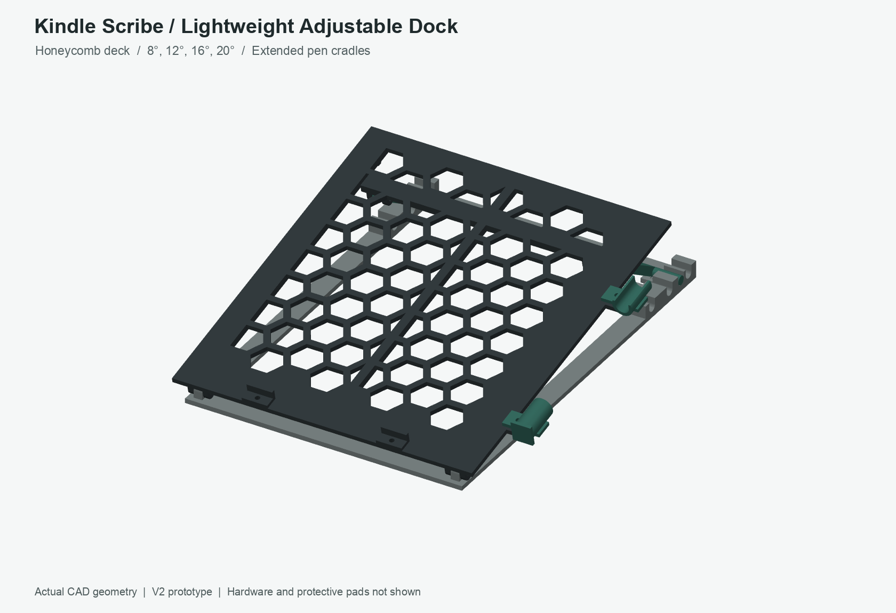
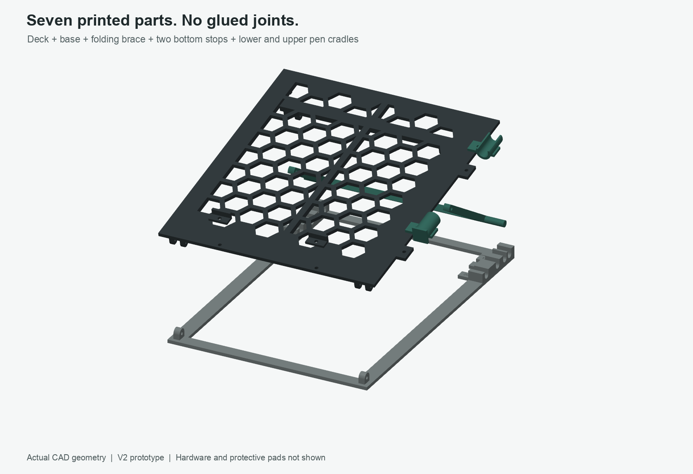
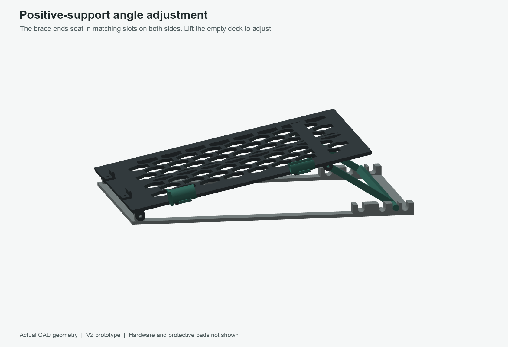
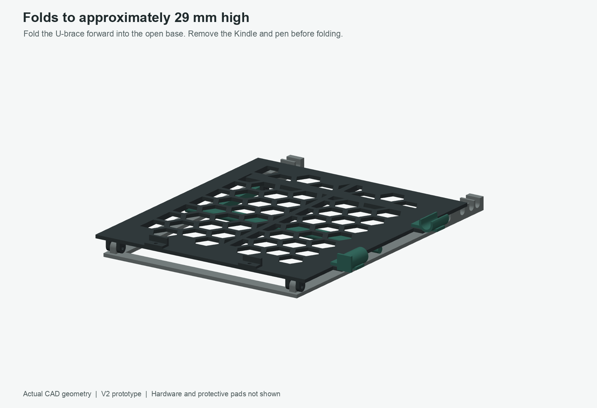

# Kindle Scribe — Lightweight Adjustable Writing Dock V2

**For the 2024 10.2-inch Kindle Scribe, without a case.** Nominal device size: 196 × 230 × 5.7 mm, excluding its small feet. Premium Pen: 162 × 8.8 × 8.4 mm. This is a new design, not a modification that reuses the old fixed-angle wedges.

**Prototype status:** The solids and STL meshes have been checked digitally. The four seated positions, folded position, and selected movement positions have been checked for part interference. The earlier 9.4 mm upper cradle passed a pen-fit test; the new 24 mm cradles and closed lower ring have **not** been physically tested or load-tested. Test the changed parts before relying on them. Do not treat it as a protective case or carry the Kindle on the stand.

## 1. What changed

The thick backing slab is replaced by a **3.2 mm honeycomb deck with continuous reinforcing ribs**. The underside ribs are 5 mm deep overall. Two small pads under the rear ribs act as fold-flat stops. The three fixed wedges are replaced by an open base and one folding U-shaped brace. Both pen-contact sections are now **24 mm long**, while each mounting tab remains **12 mm long**. The upper cradle remains open; the lower cradle is a **closed 9.4 mm inner-diameter ring** with a front end wall. Slide the pen into the lower ring from the rear, **eraser first**, then rest its rear end in the upper cradle. The lower end wall keeps it from sliding forward off the stand.

Nominal writing angles: **8°, 12°, 16°, 20°**. They are set by matching notches on the two sides, not by tightening a friction hinge. The notches are open from above: they support a downward load, but are **not a transport latch**.

The assembled footprint is approximately **232 × 282 mm**, depending on angle. Folded height is approximately **29 mm before adding rubber feet**. Each individual printed part fits within a 320 × 320 mm build plate; print the large parts on separate plates.

## 2. Print this small test first

If you need **only the two pen holders**, open `Kindle_Scribe_V2_Pen_Holders_Only_XPlus5.3mf`. It has one plate with the closed lower ring and open upper cradle, in their supplied print orientations.

In `Kindle_Scribe_V2_Complete_XPlus5.3mf`, plate 1 contains the two hinge coupons and **both revised pen holders**. Plate 2 has the base, brace and two bottom stops; plate 3 has the deck. If the hinges have already passed, print only the two holders from plate 1. `Kindle_Scribe_V2_Pen_Cradle_9p4mm_Test.3mf` is an upper-holder-only option.

Print these four files in their supplied orientation:

| File | Copies | Purpose |
|---|---:|---|
| `STL/TEST_A_hinge_deck_half.stl` | 1 | Two outer hinge ears |
| `STL/TEST_B_hinge_base_half.stl` | 1 | Inner hinge ear |
| `STL/05_lower_pen_cradle_print_1.stl` | 1 | Closed ring, pen insertion and end-stop test; reuse it in the finished stand |
| `STL/06_upper_pen_cradle_print_1.stl` | 1 | Pen fit and small bridge test; reuse it in the finished stand |

The four test pieces contain about **10.0 g of PLA at fully solid density 1.24 g/cm³**, before any brim or purge. Slide the single ear between the two outer ears and try one M3 screw. The screw must pass through freely and the hinge must rotate without forcing the ears apart. The design has a **3.4 mm screw bore** and **0.5 mm clearance on each side of the inner ear**.

Remove brim and first-layer bulges. If the screw binds, gently clean the bore or enlarge the `HOLE_D` parameter in the CAD source and regenerate. **Do not hammer in the screw or scale the entire model to correct a small hole.** Lay the pen in the upper 9.4 mm cradle; it should lift out freely without a tight snap or excessive side-to-side movement. Slide the pen into the lower ring from the rear, eraser first; its front wall must stop the pen from sliding out. Check the underside of the small bridges before printing the larger parts.

## 3. Full printing list — seven printed pieces

After the fit tests pass, open `Kindle_Scribe_V2_Final_All_Parts_XPlus5.3mf` in QIDI Studio. It contains the seven finished pieces on two plates: the base, brace, two stops, and both pen holders on plate 1; the honeycomb deck on plate 2. If you are reusing the tested pen holders, skip those objects when printing plate 1.

| STL file | Copies | Supplied printing size, approximately |
|---|---:|---|
| `01_honeycomb_deck_print_1.stl` | 1 | 219 × 242 × 14.5 mm |
| `02_notched_base_print_1.stl` | 1 | 194 × 278 × 12.5 mm |
| `03_folding_U_brace_print_1.stl` | 1 | 194 × 84.2 × 6.2 mm |
| `04_bottom_stop_print_2.stl` | **2** | 18 × 9.5 × 7.2 mm each |
| `05_lower_pen_cradle_print_1.stl` | 1 | 26 × 14.2 × 26 mm |
| `06_upper_pen_cradle_print_1.stl` | 1 | 26 × 10.5 × 24 mm |

The hinge coupons are not part of the finished assembly. Do not print second copies of either holder if the tested ones are satisfactory.

### Starting settings for the prototype

| Setting | Starting value |
|---|---|
| Filament | Your matte black PLA, using its established printer/filament profile |
| Nozzle | 0.4 mm |
| Layer height | 0.20 mm |
| Wall loops | 4 |
| Main deck and base infill | 15% gyroid |
| Brace, stops, cradles, and test coupons | 100% infill; these small/thin features are already largely walls |
| Top / bottom solid layers | 4 / 4 |
| Supports | Start with supports off; inspect the short hole/clip bridges in the slicer and test print |
| Brim | Optional 4–6 mm for the two large pieces if needed |
| Scale | 100%, millimetres |

The files are already oriented for printing. In particular, the deck prints **contact face down, hinge ears upward**. The base prints bottom down; the brace prints broad face down. The lower pen ring prints with its closed end on the bed; the upper cradle prints on its end, so each 24 mm pen-contact section grows vertically. Do not use automatic reorientation without checking these faces.

Open the STL files in QIDI Studio. Use a separate build plate for the deck and for the base. Add two copies of the bottom stop. Slice and inspect the bridges, thin walls, first layer, and estimated filament use. There is **no machine-specific G-code** in this package.

## 4. Additional hardware — no glue required

| Item | Quantity | Use |
|---|---:|---|
| M3 × 25 mm machine screws | 4 | Two front pivots and two brace pivots |
| M3 nylon-insert lock nuts | 4 | Pivot retention |
| M3 × 10 mm machine screws, non-countersunk | 4 | Two bottom stops and two pen cradles |
| M3 standard hex nuts | 4 | Stop and cradle retention |
| M3 flat washers | 12 | Two outside washers per pivot; one washer underneath each small mount |
| Equal-thickness non-slip feet, around 10–12 mm diameter | 6 | Under the base, in three left/right pairs |
| Thin, soft silicone/rubber strips | 3 | Approximately 5–6 mm wide × 200 mm long, on the deck's continuous longitudinal ribs |
| Small soft protective patches | As needed | Inside the pen cradles and on the Kindle-facing bottom stops |

Use screw heads that fit the flat mounts; countersunk heads are not intended. The four short screws do **not** need a washer above the stop/cradle: put their washer and nut under the deck. Tighten gently. Do not crush printed material or pull the pivot ears together to remove their designed clearance. A lock nut can retain a pivot while allowing it to turn; it does not need to clamp the hinge rigidly.

## 5. Assembly

1. **Prepare the parts.** Remove brim and loose strings, and smooth any sharp edges. Check the pin holes with the coupons. Keep the Kindle away from tools and loose screws during assembly.
2. **Connect deck to base.** Place the base with its notched ends away from you. The single ear at each front corner fits between the matching two ears under the deck. Insert one M3 × 25 screw through each pivot, with one washer outside each outer ear. Fit the lock nuts without squeezing the ears together. The deck should rotate freely.
3. **Attach the brace.** Its two drilled ends fit between the hinge ears under the rear of the deck. Use the other two M3 × 25 screws, four washers and two lock nuts. The wide crossbar and round protruding ends are the lower end of the brace. They will rest in the base notches.
4. **Attach the two bottom stops.** Place the stops on top of the two front mounting holes. The raised walls point toward the Kindle's bottom edge; their flat flanges and screw heads are in front of that edge. Use two M3 × 10 screws, with washers and standard nuts underneath the deck.
5. **Attach the pen cradles.** Bolt the closed lower ring to the forward right-side tab and the open upper cradle to the rear tab. The lower ring's end wall must face forward. Slide the pen into the lower ring from the rear, eraser first, then lay its rear end into the open cradle. Use the remaining two short screws, washers and standard nuts. No part should project inward against the Kindle's side.
6. **Add protective strips and feet.** Put three equal-height soft strips along the three continuous front-to-back ribs, not just four dots at the corners. Their centres are approximately 15, 105 and 195 mm from the deck's left edge. The strips should be narrow enough to stay on the solid ribs. Add six equal-height non-slip feet under the base, near its front, middle and rear, one on each side. Add thin protective patches to the stops and pen supports.
7. **Test the empty stand.** Engage both brace ends in the same pair of notches. Apply light hand pressure around the writing area and check for sliding, rocking, loose nuts, cracks, and incomplete notch engagement. Only then place the bare Kindle on it. Check the Kindle's own small feet and the added strips: the device should be evenly supported without being bent or forced flat.

Suggested foot centres are approximately 15 and 195 mm across the assembly, and 14, 140 and 264 mm from the front of the base. Use the same foot thickness everywhere.

## 6. Change the writing angle

**Remove the Kindle and pen before adjusting.** Support the deck with one hand and lift it enough to take the load off the brace. Move the two brace ends together into matching notches, then gently lower the deck so both ends seat fully. Do not drag a loaded brace over the thin notch walls or force it past a tooth.

The right-side tabs are engraved with the nominal angles. Looking from the front toward the rear:

| Notch order | Angle | Pin centre from front of base, nominal |
|---|---:|---:|
| First, closest to you | 20° | 225.81 mm |
| Second | 16° | 246.62 mm |
| Third | 12° | 260.17 mm |
| Last, farthest away | 8° | 269.09 mm |

Start at 12° and choose the position that suits your own posture and table height. The numbers describe the CAD geometry, not a guarantee of individual ergonomic comfort. Printed tolerances and pads can cause small deviations.

## 7. Fold for storage

Remove the Kindle and pen. Lift the empty deck to roughly 45°, disengage the brace ends, and rotate the brace **forward beneath the deck**. Then lower the deck gently onto the base. The brace sits inside the open frame and the small underside stops limit the folded position.

Do not try to force the brace forward with the deck almost closed; lift the deck first to give it room. There is no closed-position latch. Carry the empty stand while supporting its base. Do not carry it with the Kindle or pen installed.

## 8. Material accounting

The included `parts_and_material.csv` and `validation_report.json` give the actual mesh volumes and checks. The finished printed parts contain approximately **186.1 cm³ of modeled plastic**, equivalent to approximately **231 g at a hypothetical fully solid PLA density of 1.24 g/cm³**. This excludes hardware, pads, the two test coupons, brim, purge, and failed prints. Your actual filament density may differ.

The new geometry has approximately **62% less solid CAD volume** than the original uploaded plate plus three wedges. This is a **solid-volume comparison, not a sliced-filament saving claim**. The earlier 330–380 g estimate for the old version was not a measured slicer result; do not compare it directly with this fully-solid calculation. Use QIDI Studio's sliced result for the material you will actually consume.

## 9. Included files and validation limits

`STL/` contains the print-oriented files. `STEP/` contains individual CAD solids and reference assemblies at 0°, 8°, 12°, 16°, and 20°. The STEP files use assembly coordinates rather than the STL printing orientations. **Do not print the assembled reference STEP files as a single object.**

`make_design.py` is the editable CadQuery source. It requires CadQuery 2.8+, trimesh and numpy; the small engraved labels use an installed DejaVu Sans font, which can be replaced with another installed font name. Run it to regenerate the CAD and meshes, then run `check_motion.py` for the additional sampled checks. The optional preview renderer also requires VTK and Pillow. CAD changes require rechecking the fits and linkage geometry; scaling all parts will also scale screw holes and change device clearances.

Every printable STL was checked as a watertight, consistently oriented, single connected solid. All four nominal deployed poses and the folded pose have no detected solid intersections greater than 0.02 mm³. The separate motion report checks 39 selected positions during folding, brace swing, and notch entry/exit. This is not a continuous swept-volume proof or a simulation of manufacturing tolerances. Hardware, soft pads, and a detailed Kindle body are not included in those collision checks. There has been no physical test or structural/load certification.

Use only as a tabletop writing support after your own fit and stability checks. Do not lean body weight on it, leave it in a hot car, or use a cracked/warped part. The open deck is not an impact-protective enclosure. Check pivots and notch walls periodically, and adjust only with the device removed.

## 10. Dimensional references

Amazon's 2024 Kindle Scribe product specifications, including device and pen dimensions: https://www.amazon.de/kindle-scribe-2024/dp/B0CZ9T8H8N

QIDI Plus5 published build volume, 320 × 320 × 300 mm: https://eu.qidi3d.com/de/products/plus5

Pen-holder revision: 13 October 2026. This is an independent prototype, not an Amazon or QIDI product.
