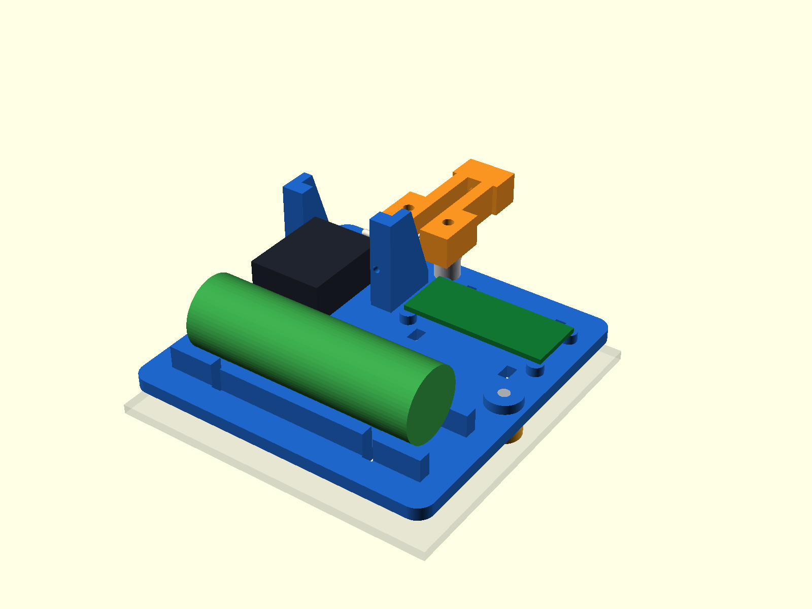

# Smart bin prototypes

## Current Stage 3: shared rear holder and string pull

The **provisional** design uses one 96 × 96 mm printed plate on the stationary rear wall to carry the SG90, Arduino Nano carrier and an **insulated** 21700 cell holder. A separate fixed guide arm bolts to that plate through two M3 holes and rises above it. A line tied to a hole in the **original servo horn** runs between the arm's two rails, through the two intersecting tip bores, and to a **top-side** attachment on the moving lid. The arm does not pivot. The two original side hinges remain in place. The user said the stationary rear wall may be drilled later; the plate's two 3.5 mm M3 holes are a drilling template with proposed 82 mm spacing. The earlier bell-crank/rod design below remains available as a previous prototype.

| Stage 3 file | Purpose |
| --- | --- |
| `string_mount_parameters.scad` | Editable dimensions and layout, with measured and provisional values labelled |
| `string_main_holder.scad` | One-piece holder; `part` selector also exports coupon, spacers, batch and visual preview |
| `string_guide_arm.scad` | Removable 24 × 43 × 10 mm fixed guide arm and two 8 mm M3 standoffs |
| `string_lid_anchor.scad` | Provisional 80 × 16 mm two-point top-side lid tab with 2.2 mm cord eye |
| `exports/string_servo_ear_coupon.stl` | **Print first:** 42 × 11 × 24 mm ear-finger fit coupon |
| `exports/string_main_holder.stl` | 96 × 96 × 33 mm integrated rear holder |
| `exports/string_rear_bolt_spacer.stl` | 6 mm spacer; print two for the M3 mount holes |
| `exports/string_rear_corner_pad.stl` | Optional 6 mm nonfastening corner pad; print four if rear wall needs extra support |
| `exports/string_guide_arm.stl`, `exports/string_guide_arm_standoff.stl` | Arm plus two spacers; two M3 fasteners hold it to the main plate |
| `exports/string_lid_anchor.stl` | Lid tie fit tab; do **not** drill lid from this unmeasured hole pattern |
| `exports/string_mount_batch.3mf` | Geometry-only plate with holder, coupon, fixed arm, lid tab, two rear spacers, two arm standoffs and four corner pads |
| `exports/string_mount_batch_preview.png` | All 12 printed pieces on one plate |
| `exports/string_mount_layout.png` | Schematic placement of the servo, Nano, cell and horn line |
| `exports/string_motion_0.png`, `exports/string_motion_45.png`, `exports/string_motion_90.png` | Provisional geometrically constrained closed/half/open string route with both original side hinges |
| `exports/string_motion_provisional.csv` | Required horn angles and string pull for the *assumed* geometry |
| `exports/string_mount_drill_face.png` | Plate hole positions and strap slots, seen perpendicular to plate |
| `string_motion_check.py`, `export_string_mount.sh` | Checks provisional string travel; rebuilds and checks all Stage 3 exports |

Run `./export_string_mount.sh` after changing parameters. It exports and checks each binary STL as a watertight, consistently oriented shell. The one-job batch contains 12 separate bed-contacting shells within 115.5 × 153 mm. Test its small servo coupon before drilling or assembling the full plate. In QIDI Studio confirm all 12 pieces, the printer and filament settings, and the actual slice. Use black PLA, 0.4 mm nozzle, 0.2 mm layers, four walls and 30–40% infill for fitting. The holder, arm and lid tab all print flat; inspect the two intersecting 4 mm arm-tip bores and upright servo fingers for bridge quality or local support. The servo-ear screws, M3 bolts/washers/nuts, insulated cell holder/contacts and power electronics are real hardware; printed pins or a bare printed battery cradle do not replace them.

Assembly after dry fit: (1) seat the servo between the raised fingers with its shaft/horn toward the top of the plate; fasten both ears with correctly sized screws, (2) fasten the guide arm to the two top plate holes with **two** M3 bolts, washers and nuts, using the **two 8 mm standoffs between arm and plate**; the arm's open channel faces the horn, (3) strap the Nano carrier and insulated 21700 holder through their respective slots, keeping USB and wiring accessible, (4) hold the plate against the **stationary** rear flat with 6 mm spacers behind its two M3 mount holes, check the rear rib and swing the lid by hand, (5) only after placement is confirmed, use the plate as a drilling template and secure it without crushing the wall, (6) with power off, tie a nonstretch line to a real hole in the original horn, pass it up the arm channel and through the smooth tip eye to a confirmed **top-side** lid tie point. Assemble the arm before mounting the rear plate so its M3 nuts remain accessible.

For a **provisional** lid tie 10 mm from the hinge, 3 mm above the lid, with the line exit 22 mm above and 12 mm behind the hinge, the constrained string model requires **14.07 mm** pull from 0° to 90°. A nominal 14 mm original-horn hole rotated from 90° toward 0° gives at most **16.20 mm** through this fixed inlet; the model solves approximately **71° of servo rotation**, has no mathematical over-center from 0° to 90°, and keeps the simplified line at least about **10.5 mm above the rear rim**. These are *assumptions*, not observed dimensions or a usable-servo-range test. A tie point on the lid **underside** would make this direct string route pass through the closed lid; it must be above or behind the moving panel. The printed top-side tab uses provisional 40 mm hole spacing; the visible existing holes may be blind underneath, so its fastening method is unresolved. **Do not drill or power the lid from this CAD.**

String tension and motor torque have not been verified. The lid weight, hinge friction, actual guide placement, horn-hole radius, lid-hole spacing, usable servo travel, and clearance to the real rim/hinge must be checked. A single pulling string opens; gravity or a measured return spring must close it without slack or sticking. Hand-sweep 0°, 30°, 45°, 75° and the intended full-open angle before energising. Also verify the actual 21700 cell/holder envelope and power arrangement: one lithium-ion cell is not a direct replacement for both the Nano regulated 5 V and SG90 supply.

### Known values and remaining measurements for Stage 3

The bin envelope is 140 × 140 × 200 mm; the stationary rear flat was measured as 100 × 100 mm; a nearby rib protrudes about 5 mm. The 3 mm wall figure came from a previous location and is **not** confirmed rear-wall thickness. The user can drill M3 holes later, so no existing rear hole spacing is assumed. Before a powered build, measure the actual servo ear-hole alignment on the coupon, Nano carrier outline/USB side, 21700 insulated holder outline, rear wall thickness at the planned drilling points, rib footprint, the two lid-hole spacing and strength, and the intended line anchor distance from the hinge axis. These drive the final holder, screw length, string travel and torque check.

Published reference envelopes: [TowerPro SG90](https://towerpro.com.tw/product/sg90-7/) and [Arduino Nano Classic](https://docs.arduino.cc/hardware/nano). They are catalogue starting points, not proof that the particular servo, board carrier or cell holder fits.

## Earlier Stage 2 bell-crank prototype (retained)

The 140 × 140 × 200 mm bin keeps its two original side-edge lid hinges on one shared rear axis. A stationary rear servo drives its original horn, a 65 mm lower rod, a fixed bell crank, a 40 mm upper rod and the moving lid. The model contains no string, pulleys, gears or printed servo spline.

## Status and measured values

**The user reports the first batch printed.** A second plate now contains a provisional SG90 body holder, a removable cap, replacement lid pad and longer printed pins. These are **unpowered fit prototypes**, not a verified powered build. The actual servo ears/cable, bin attachment, usable servo travel and load capacity remain unmeasured. A secure all-printed fixing of the rear plate to the bin is still unresolved.

**Physical lid-pad result (2026-10-13):** the user measured about **0.4 mm of movement** at the printed attachment pad on the moving lid. The direction, cause and behavior under linkage load are not yet known. Its single elongated fixing slot provides no positive anti-rotation feature. Treat this pad as a rod-joint bench-fit part rather than a verified powered lid mount. The replacement needs two positively retained mounting points or another measured, non-slip fixing. The spacing and retention method for the two visible lid holes are still unconfirmed.

| Measurement | Value | Use |
| --- | ---: | --- |
| Bin envelope | 140 × 140 × 200 mm | Simplified assembly body |
| Stationary rear flat region | 100 × 100 mm | Bounds proposed plate |
| Rear rib/bump height | approximately 5 mm | 6 mm proposed standoff clearance |
| Available mounting width | 120 mm | Width only; **not** strap circumference or route |
| Rear wall thickness | 3 mm | Earlier measurement at one location, **not** full rear cross-section |
| Installed horn underside to servo case | approximately 6 mm | User measured with a ruler; boss clearance still unmeasured |

The user confirms the lid seats **inside the top opening**; the exterior stationary rear area is outside its main closed-lid footprint. This removes the earlier concern that a rear plate by itself must hold the lid open. Its hinge-side moving parts and the rod still need a full sweep check. The current assembly represents the lid panel as a simplified plane at the hinge datum; the actual inset depth is not measured. The rib's **position and width are unknown**. The proposed 70 × 80 mm plate, its vertical location, corner feet, M3 interface holes and 20 mm strap slots are adjustable values in `parameters.scad`, not measured facts. A loose strap is not a safe load-bearing mount. Do not attach any part to the moving lid except a confirmed lid-side attachment. The front photo with the lid open shows **two separate side hinges** and **two small holes in the lid underside**. Their diameter, depth, spacing and strength cannot be established from the photo; the current top-side lid pad must be revised if they are blind or otherwise unsuitable.

## Source and generated files

Run `./export.sh` in this folder. It needs OpenSCAD CLI, Python 3 and FFmpeg. It runs the constrained linkage solver, exports separate binary STLs, checks every STL for a watertight oriented shell, and renders labeled 0/30/45/75/90° views and a looping GIF/MP4.

| Source | Export | Status |
| --- | --- | --- |
| `rear_rib_clearance_test.scad` | `exports/rear_rib_clearance_test.stl` | **Print first**; 50 × 24 × 9.2 mm bridge gauge |
| `rear_mount_test.scad` | `exports/rear_mount_test.stl` | Earlier 56 × 32 mm strap saddle coupon; retain |
| `servo_fit_test.scad` | `exports/servo_fit_test.stl` | Existing SG90/MG90S fit test |
| `rear_servo_mount.scad` | `exports/rear_servo_mount.stl` | 70 × 80 × 11 mm rear plate prototype |
| `rear_servo_holder.scad` | `exports/rear_servo_holder.stl` | Provisional SG90 rear body cradle; shares four support/plate holes |
| `servo_holder_cap.scad` | `exports/servo_holder_cap.stl` | Removable test cap for servo body |
| `rear_stack_pin.scad` | `exports/rear_stack_pin.stl` | Experimental offset-head 15.5 mm grip pin to clear the old plate feet |
| `bell_crank_support.scad` | `exports/bell_crank_support.stl` | Provisional 133 mm high pivot support, no load test |
| `bell_crank.scad` | `exports/bell_crank.stl` | Provisional two-arm crank, flat-print |
| `pushrod_servo.scad` | `exports/pushrod_servo.stl` | Provisional 65 mm centre distance |
| `pushrod_lid.scad` | `exports/pushrod_lid.stl` | Provisional 40 mm centre distance |
| `lid_attachment.scad` | `exports/lid_attachment.stl` | Rod joint bench-fit only; one-slot lid fixing is physically loose |
| `lid_joint_preview.scad` | `exports/lid_joint_preview.png` | Local fit view of revised pad, 2 mm spacer and existing 40 mm rod |
| `spacers.scad` | `exports/spacers.stl` | One 2 mm M3 spacer; print needed count after stack measurement |
| `pivot_fit_pin.scad` | `exports/pivot_fit_pin.stl` | Smooth 3.0 mm hand-fit gauge, **not** a threaded bolt or working pivot |
| `printed_joint_pin.scad` | `exports/printed_joint_pin.stl` | Experimental 3 mm headed pin with retainer groove |
| `printed_joint_clip.scad` | `exports/printed_joint_clip.stl` | Experimental matching C-clip; print extras |
| `horn_gap_gauge.scad` | `exports/horn_gap_gauge.stl` | Nine labeled 0.6–3.8 mm tongues for the installed horn-to-case gap |
| `horn_tapered_saddle_test.scad` | `exports/horn_tapered_saddle_test.stl` | Two-piece pocket shaped from the reported horn gauge fit; **not for powered use** |
| `remaining_fit_parts.scad` | `exports/remaining_fit_parts.3mf` | Compact black-PLA hand-fit plate: tapered saddle, cap, four retaining pins and six clips |
| `remaining_holder_horn_fit.scad` | `exports/remaining_holder_horn_fit.3mf` | Earlier inventory variant with holder/cap and tapered saddle/cap; retained |
| `remaining_cap_horn_fit.scad` | `exports/remaining_cap_horn_fit.3mf` | Earlier inventory variant with cap and tapered saddle/cap; retained |
| `remaining_servo_holder_fit.scad` | `exports/remaining_servo_holder_fit.3mf` | Old cradle orientation; **hold this print** while the ear-bolted flip is checked |
| `servo_ear_fit_instruction.scad` | `exports/servo_ear_fit_instruction.png` | Schematic: body through Stage 1 coupon, ears rest over the two holes |
| `horn_clearance_study.scad` | `exports/horn_clearance_closed.png`, `exports/horn_clearance_open.png` | Correct outward-facing saddle against simplified holder and fixed support |
| `batch_remaining.scad` | `exports/batch_remaining.stl` | Single-plate layout of 35 remaining shells, excluding already printed crank and rib test |
| `batch_servo_holder_lid.scad` | `exports/batch_servo_holder_lid.3mf` | Geometry-only fit plate: revised holder, lid pad, horn gauge, four straight and one tapered saddle candidates, and printed trial joints |

The old side-rim and one-rod sources remain in the project or `legacy/`; old STLs are under `exports/retired/`. `legacy/one_rod_lid_attachment.scad` preserves the previous lid part. No Git commit was made.

### One-plate prototype print

`exports/batch_remaining.stl` contains the rear plate, upright pivot support, upper/lower rods, provisional lid pad, servo-fit coupon, four spacers, two loose fit pins, eleven grooved joint pins (eight 10.5 mm grip and three 8 mm grip), and twelve C-clips. The file spans **229.36 × 158.40 × 133.00 mm**. Each source STL passed a watertight shell check and the combined file passed a **35-shell** check. Open it once in QIDI Studio with a single black PLA filament, then inspect the slice before starting: all 35 parts must be present, lie on the bed, and fit the selected plate. Add a generous brim for the 133 mm tall support and small pins; inspect the support flange and horizontal holes for any needed localized supports. Use 0.4 mm nozzle, 0.2 mm layers, four walls and about 30–40% infill.

This first batch is for one fitting session, **not** a guaranteed complete assembly. Its printed lid pad has a rod interference and is superseded by the second 3MF plate below. The bin still has no verified all-printed retaining clamp, and the lid pad uses an unmeasured hole location.

### Second print: missing fit parts

**Next fit check (orientation correction):** the user clarified that the original-horn mounting part is **already printed** and wants the SG90 **flipped, with bolts through its two ears**. Hold `exports/remaining_servo_holder_fit.3mf`: it contains the earlier body-cradle orientation and is superseded for this request. First use the already provided Stage 1 `exports/servo_fit_test.stl` coupon. Feed the servo's **cable/body end down through the central rectangle**, leaving its shaft and original horn above the coupon, until both mounting ears rest on the face with the two round holes. Verify the body fits without force and both actual ear holes line up; do not force a bolt through the plastic ears. `exports/servo_ear_fit_instruction.png` and `exports/servo_ear_fit_instruction_top.png` illustrate the seated and top views. The nominal 28 mm ear pitch and 2.2 mm M2 clearance holes are **provisional**; the catalogue body envelope alone does not prove hole fit. Once the coupon is checked, redesign the rear holder for the reversed shaft direction and ear bolts, then revalidate the rod plane and collision sweep. The old holder plate is not the final flipped mount.

The Stage 1 servo-fit coupon is **only a gauge**. It does not bolt to `rear_servo_mount`: its two nominal ear holes have a different pattern from the rear plate's four 36 mm-pitch structure holes. The intended fixed stack is bin rear wall → rear plate feet/plate → bell-crank support flange → a **new flipped ear-bolted servo adapter** → SG90 ears. That adapter has not been exported yet because the real ear fit and flipped horn/rod clearance are unverified. Do not drill the bin or attach the coupon as a load-bearing bracket.

For a rotatable 3D assembly view, open `flipped_full_assembly_concept.scad` in OpenSCAD. Rendered views are `exports/flipped_full_assembly_concept.png` (top 80 mm of bin and both original side hinges) and `exports/flipped_mechanism_closeup.png` (mechanism detail). The green translucent adapter, servo ears/bolts and shaft are schematic. The green part does **not** connect to the blue support in the current CAD; its load-bearing geometry has not been designed. The orange rods, purple crank and white lid pad show the existing provisional constrained linkage at 45 degrees. These images are assembly concepts, not fit or collision validation for the flipped servo. To render the detail view: `openscad -D 'detail_mode=true' -o exports/flipped_mechanism_closeup.png flipped_full_assembly_concept.scad`.

To see the **existing green servo-holder design and cap** in the same 3D assembly, use `exports/existing_holder_full_assembly.png` or the larger `exports/existing_holder_mechanism_closeup.png`. In OpenSCAD, set `existing_holder_view=true` in `flipped_full_assembly_concept.scad` and rotate the model. After user fit feedback, these images show the servo reversed in the cradle, with its shaft at the cap end (+Y). The translucent red 65 mm rod is deliberately disconnected: the reversed shaft no longer matches the original solver location or rod plane. The horn saddle and verified rear-wall fixing are not installed in this view. The user last clarified that the horn saddle, rather than this holder, had been printed; current physical print status of the holder has not been reconfirmed.

`servo_holder_exploded_guide.scad` gives a close 3D view of the body-cradle holder with the servo **reversed as reported to fit**. See `exports/servo_holder_exploded_guide.png` for the separated parts and `exports/servo_holder_seated_guide.png` for the seated stack. Dark blue is the rear plate, lighter blue the bell-crank support, dark green the holder tray and rails, light green the cap, black the schematic servo, and orange the printed pins. The four 15.5 mm grip pins run from the rear plate foot side through plate, support flange and holder rails; their C-clips seat on the holder side. Two 9 mm grip pins retain the cap across its side lugs. The original horn is shown only as a white schematic arm at the cap end. No horn saddle, moving pushrod or verified rear-wall fixing is included in this close-up. These views show hand-fit sequence, not a powered final assembly. Bolting through the servo ears still requires an adapter.

`exports/rear_servo_mount_bolt_path.png` is an exploded schematic of this stack. Its black arrows show the rear plate/support/adapter M3 path; the orange arrow shows the separate M2 servo-ear path. It is not to scale and does not represent a printable adapter.

Open `exports/batch_servo_holder_lid.3mf` in QIDI Studio only when continuing the **unpowered fit tests**. It is a **geometry-only 3MF**, with no printer, filament, or support profile embedded. The plate contains **84 watertight shells**: one revised rear servo holder, one holder cap, one corrected lid pad, six offset-head 15.5 mm grip support pins, four 9 mm grip holder-cap pins, the original twelve C-clips, one four-slot horn fit gauge, four straight captured-hub saddle bases and matching caps, one tapered saddle base and matching cap, twenty 7 mm grip saddle pins, two 14 mm grip upper-crank pins, and twenty-six additional C-clips. Its footprint is **190.9 × 271.0 mm** and the tallest part is **52.8 mm**. This is within [QIDI's published 320 × 320 × 300 mm Plus5 volume](https://us.qidi3d.com/products/plus5). Use black PLA for the fit test with a 0.4 mm nozzle, 0.2 mm layers, four walls and 30–40% infill. Add a brim for the tall holder and small pins. Inspect the slice for support under the cantilevered servo tray; the saddle bases, caps, lid pad and gauge should print flat. Confirm every piece contacts the bed before printing.

The holder rails fit against the **outside of the existing bell-crank support flange**. The four offset-head 15.5 mm grip pins replace the old 10.5 mm pins through rear plate + support + holder (nominal 5 + 5 + 5 mm). Insert each pin **from the plate's foot side**, rotating its wide head lobe **away from the nearest round foot**. The clip then seats on the accessible holder side. Standard round clips on the foot side overlap the existing feet; the offset head gives only about **0.4 mm nominal clearance** there, so check the actual print without force. Per user feedback, the servo body fits only when reversed from the first guide, with the shaft/horn at the cap end. Place the cap over that end only if the real horn, boss and cable clear it; use two 9 mm grip pins and clips through the side lugs (nominal stack 4 + 0.35 + 4 mm). Do not force the cap across the servo ears or cable. The reversed shaft is not connected to the current 65 mm rod model, so stop at an unpowered hand-fit test. The holder uses catalogue SG90 dimensions and an adjustable 0.3 mm body gap; its cap position, ear/cable accommodation and physical clearance remain provisional.

The combined STL passed an **84-shell** watertight mesh check; its 3MF and STL have the same 9,458 triangles. The holder's forward tray and one rib were trimmed/repositioned using the reported 6 mm horn gap. The revised tapered saddle has **no modeled intersection** with the holder, support, plate, schematic servo body, simplified bin or lid at 19 poses from 0–90° in 5° steps. The old printed holder, if already printed, has **not** passed this saddle check. Rod-plane alignment and the real raised boss remain unresolved, so this does not establish physical fit or structural reliability. The rear plate still lacks a verified removable attachment to the bin.

## Simulation and assumptions

Coordinates are side-view X/Z in mm. The shared hinge axis is (0,0), positive X into the bin, negative X behind. **All pivot coordinates are provisional.**

| Feature | X, Z or length |
| --- | ---: |
| Lid pivot, local to closed lid | (25, 9) |
| Bell pivot | (−26, 36) |
| Bell upper/lower radii, angle | 25 / 16 mm, −98° |
| Upper rod | 40 mm centre-to-centre |
| Servo shaft | (−60, −23) |
| Original horn hole radius | 14 mm, **unverified** |
| Lower rod | 65 mm centre-to-centre |

`mechanism_solver.py` solves both circle intersections at 181 positions from 0–90°. It checks constant rod lengths, one continuous monotonic branch, no modeled toggle, lower rod behind the nominal back and upper rod above the simplified lid/rim. The crank moves 7.40→91.02°; the horn needs **99.38° relative travel**. Actual usable SG90/MG90S travel has **not** been experimentally verified; `bell_verified_servo_travel = -1` leaves that check open. If measured, set it to the usable degrees and rerun `./export.sh`. The assembly render shows the new rear plate and both original corner hinges. The render uses a top-80-mm cutaway for visibility, while the source defaults to 200 mm body height.

The modeled clearance does not cover actual hinge offsets, rib position, lid ribs, screw heads, servo ears/cable, mounting hardware or strap. The support and servo body in the animation remain schematic. A simplified torque estimate peaks at **0.099 N·m (1.01 kg·cm)** assuming a 120 g lid, 70 mm hinge-to-centre-of-gravity, 0.015 N·m hinge friction and 70% mechanism efficiency. None is measured. Servo stall torque is not a continuous-duty rating.

## Fit sequence and print orientation

1. Print `rear_rib_clearance_test.stl` in **black PLA**, with its broad 50 × 24 mm bridge face on the QIDI Plus5 bed and two feet pointing up. Use a 0.4 mm nozzle, 0.2 mm layers, four walls and 30–40% infill; no supports. Invert it for fitting: both feet touch the **stationary** back, bridging the rib. The 6 mm feet should leave roughly 1 mm over a 5 mm bump *only if the bump fits within the 28 mm clear span*. Do not force it.
2. Mark the rib position/width within the measured 100 × 100 mm patch. Hold the gauge at candidate plate locations with the lid closed, halfway and fully open. Note whether both feet lie flat and whether any position blocks the lid or removable liner.
3. Test `servo_fit_test.stl` flat on the bed against the real servo and original horn. Measure the shaft-to-horn-hole distance and usable servo sweep before connecting a rod.
4. **Hold the full plate print** until the small gauge fits and a removable strap route or another secure nondrilling attachment is confirmed. The 120 mm width alone does not establish such a route. The plate's feet assume the rib lies between them.

With the rib gauge and bell crank already printed, the **next low-cost geometry tests** are the 65 mm and 40 mm rods. Print them flat. They can check nominal pivot fit and the proposed lengths, but cannot establish physical linkage fit until hinge, horn and lid pivots are measured.

If M3 hardware is not on hand, print `pivot_fit_pin.stl` upright with its 7 mm head on the bed to check the crank and rod holes gently by hand. Its smooth shaft is 3.0 mm diameter and 14 mm long with a 1 mm tapered tip. Small FDM diameters vary; it is only a rough fit check, not an accurate bolt gauge. The grooved `printed_joint_pin` and `printed_joint_clip` form a removable all-printed joint for unpowered trial assembly. Fit the clip into the groove without forcing it; discard any cracked or loose piece. These 3 mm layer-built pins and PLA clips have no demonstrated fatigue or retention capacity under servo load. A dependable powered all-printed version may require larger pivots and reprinted crank/rods after fit testing.

For later fitting prototypes, print the crank and both rods flat with pivot holes vertical; print spacers flat. The pivot support can lay on its broad side but may need localized supports around its perpendicular flange; inspect the slicer before printing. Print the lid pad flat with its tab upward; its horizontal M3 hole may need light cleanup. The flat rear plate can print broad face down but its standoff feet require the face to be supported or reoriented; inspect the slicer. All M3 running holes are provisionally 3.4 mm and must be checked with actual bolts. Do not use a self-tapping M3 bolt through an unmeasured plastic servo horn.

## Mechanical assembly after measurements

### Bench fit with the current prints

See `exports/assembly_labeled.png` for a labeled side-view visual of the provisional linkage. It was annotated from the CAD preview and is not a measured physical fit.

**Lid pad correction:** The pad in the original batch print does **not** fit the 40 mm rod: its base extends into the rod's pivot sweep, and its pivot hole opens through the tab top. That STL is saved as `exports/retired/lid_attachment_v1_interference.stl`. The revised `exports/lid_attachment.stl`, included on the second 3MF plate, ends the base at the tab's outer face and leaves 2.5 mm of material above the pivot hole. The model now uses the printed rod's actual 4 mm thickness; its rod-side gap is 1 mm before adding a spacer. Keep the already printed 40 mm rod. For a hand-fit trial, put a 2 mm spacer between tab and rod: tab + spacer + rod make a 10 mm stack for a 10.5 mm grip grooved pin. Use it only if the clip seats fully and the joint swings freely. **The user measured about 0.4 mm of play at this pad on the lid.** The source of the play is unconfirmed; the one-slot mount has no positive anti-rotation feature. Use it only for rod-pivot bench fitting until the lid fastening is revised and tested.

1. Set aside the rear rib test, servo-fit coupon and two smooth fit pins. They are gauges, not working parts of the linkage. Identify the long 65 mm centre-to-centre rod (servo to crank), short 40 mm rod (crank to lid), three-hole bell crank, tall support, rear plate, lid pad, four 2 mm spacers, grooved pins and C-clips.
2. Place the rear plate with its four round standoff feet toward the **stationary rear wall**. On the bench, put the tall support's rectangular four-hole flange against the plate's smooth outside face, tower upward. Place the new servo-holder rails against the outside of that flange. Align all four holes and use four offset-head 15.5 mm grip pins through the nominal 5 + 5 + 5 mm stack, inserted from the plate's foot side with each head lobe away from the nearest foot. Clip on the holder side. Use a pin only where the clip seats fully and the parts do not flex or rattle. Do not fix the plate to the bin yet.
3. Place the crank's large central hole beside the support's top hole. The crank's 25 mm arm leads toward the lid; its 16 mm arm leads toward the servo. Try one spacer between the crank and support cheek and a grooved pin through the stack. The parts must rotate freely without a loose or forced retainer.
4. Offer the **65 mm** rod to the short crank arm and the **40 mm** rod to the long crank arm. Check that both rod joints can pivot freely. The CAD places the 40 mm rod on the opposite side of the crank from the 65 mm rod; that upper joint spans about 13.1 mm from outside face to outside face, before any extra running clearance. The second 3MF now includes two **provisional 14 mm grip pins** for this joint. Use one only if the clip reaches its groove fully and the rod rotates without rubbing; otherwise resize the pin and spacer stack.
5. Hold the plate loosely at the fixed rear wall and hand-swing the original lid through its range. Keep the support, rods and lid pad clear of both side hinges. Do not attach the pad to the lid from the provisional hole location or put the servo under power. The second print adds a provisional servo body cradle; servo ear/cable fit and a removable bin fixing remain unverified.

Send a ruler photo of the plate/support stack, crank/rod stack, fixed rear wall and lid holes to set pin lengths, create the missing carrier/fixing and revise the lid pad. Preserve the original servo horn and both original hinges.

1. Fit the rear gauge and the new carrier on the bench, then confirm a non-slip removable fixing route for the rear plate before loading the mechanism.
2. For an unpowered mock-up, try the printed pins and C-clips through the plate/support and bell-crank/rod holes. Adjust `joint_grip_length` to the real stack if a clip cannot reach its groove or leaves too much side play. The existing crank holes are 3.4 mm; forcing an oversize printed pin can split PLA.
3. Seat the original servo horn on the servo spline and retain it with its original centre screw. Use the four-slot gauge to select a matching **provisional captured-hub saddle** from the second 3MF. Place the hub in the wider cavity and the arm in the narrow channel; secure the cap with four 7 mm grip pins and clips outside the horn. The cap's centre opening must leave the original horn screw accessible. Put the 65 mm rod over the saddle's integral pivot and retain it with a clip. Check the 14 mm shaft-to-pivot radius and rod-plane alignment. Do not force the horn into a saddle or use the centre screw as the rod pivot. The provisional servo carrier and all-printed bin fixing need real fit/load tests before powered use.
4. With the servo **unpowered**, hand-cycle from fully closed through 30°, 45°, 75° and the real open stop, then back to closed. Stop for binding, slippage, lid/rim contact or a horn hard stop. Measure the actual servo travel and lid load before powering it.

## Horn-to-65-mm-rod fit test

**Physical gauge result (2026-10-13):** the user reports that slots 2 and 3 fit near the horn tip; slot 3 slides inward to the fourth accessory hole **counted from the outer tip**; slot 4 reaches the hub but is loose at the tip. This indicates the arm widens toward its hub. The full arm profile and actual hub diameter remain unknown. Do **not** select a constant-width saddle solely from the tip fit: a narrow channel may stop short of the hub, while a wide channel has too much play at the tip. `horn_tapered_saddle_test.scad` now has a provisional channel that transitions from a 5.25 mm hub-side opening through 4.85 mm near the inferred fourth-hole station to 4.45 mm at the tip. Those openings include a nominal 0.25 mm FDM allowance and still require a physical fit test.

The user subsequently reported an approximately **6 mm gap measured with a ruler** from the servo case to the underside of the installed horn. This is entered as `horn_case_gap` in `parameters.scad`; clearance over the raised output boss is still unverified. The nine-tab `exports/horn_gap_gauge.stl` tops out at 3.8 mm and is no longer needed for this measurement. The **two-piece tapered saddle test STL** is the next small print for a gentle, unpowered horn fit. It does not solve the rod-plane mismatch; hold the full 3MF until that is redesigned.

An initial no-support fit gauge is provided as `horn_fit_gauge.scad` / `exports/horn_fit_gauge.stl` (54 × 16 × 3 mm). Print flat and try the horn's outer tip in each slot without forcing it. Slots from left to right are 3.8 × 2.0, 4.2 × 2.2, 4.6 × 2.4 and 5.0 × 2.6 mm. These are **trial openings**, not claimed SG90 standards. Record the first easy sliding fit; this replaces the need for a ruler photograph of the horn tip. The gauge does not measure the shaft-to-pivot radius or actual axial clearance.

The plate includes four original constant-width candidates and one new **tapered captured-hub candidate**. The geometry follows the [supplier drawing of SG90 single-arm horn #4](https://www.auselectronicsdirect.com.au/assets/brochures/TA0132.pdf): approximately 16 mm arm reach, 6.9 mm hub diameter and 1.5 mm arm thickness. Each saddle has a wider closed hub cavity, a narrower arm throat and a distal stop; the hub cannot withdraw through the arm throat in the *published* geometry. A cap with an access hole leaves the original centre horn screw available. Four vertical 7 mm grip pins outside the horn hold the cap; an integral 3 mm pivot takes the rod's 3.4 mm hole and a printed C-clip. First try the tapered candidate by hand; confirm the actual hub fits, the original screw remains accessible, all four cap clips seat, and the rod rotates freely. This drawing applies to one supplier's horn variant; print fit is still unverified. Do not power the servo from a CAD fit alone.

The reference horn envelope was checked against the tapered saddle in CAD; it has no modeled volume overlap when positioned with a small floor clearance. `exports/horn_saddle_assembly_preview.png` and `exports/horn_saddle_exploded_preview.png` show that provisional fit. The test does **not** establish the dimensions of the actual horn supplied with the user's servo. The outward-facing saddle now passes the 19-pose simplified holder/bin/lid collision check, but it is **not yet connected to the constrained rod motion**. The earlier approximately 2 mm axial mismatch estimate used the saddle in the wrong direction, with its cap toward the servo; discard that estimate and the associated trial servo shift. The cap and rod pivot must face **away from** the servo. With the measured 6 mm case-to-horn gap, the 2 mm saddle floor leaves about 4 mm nominal space to the flat case plane, subject to the unknown raised output boss. The tapered saddle's nominal stack places the 65 mm rod center at approximately Y = -21.8 mm, while the current assembly assumes Y = -7 mm: an approximately **14.8 mm lateral mismatch**. The holder, crank joint stack and lid-side joint must be redesigned together before a powered fit. Do not force the printed rod into that offset or power this prototype.

The current solver assumes a 14 mm shaft-to-rod-pivot radius. Verify that the tapered saddle seats fully at that radius. The existing 65 mm rod plane **does not align** with the installed saddle in the current model; revise the linkage/servo position and rerun the solver before powering. SG90 horn shapes and accessory holes are not fixed by the manufacturer's servo body dimensions. Printed PLA pivot pins and clips remain hand-fit parts until their retention and fatigue are verified; use correctly sized metal fasteners for a dependable powered mechanism if the all-printed joint cannot pass testing.

## Measurements still needed

- Rib position and width, and rear flat patch position relative to the hinge axis; a ruler photo of the fixed back.
- Real full strap path/circumference or an alternative removable fixing; 120 mm is only available width.
- Rear free space behind the bin, including furniture, and whether the proposed 133 mm support is possible.
- Lid hinge-axis offset, thickness, actual open angle, mass, centre of gravity and opening force.
- Existing lid hole/boss position and strength; do not drill from provisional CAD.
- SG90/MG90S body/ear/shaft dimensions, horn hole centre radius and size, and experimentally usable servo angular travel.

These values decide the final servo carrier, plate feet, fastener lengths and whether the provisional 65/40 mm rods and 90° opening can be used.
